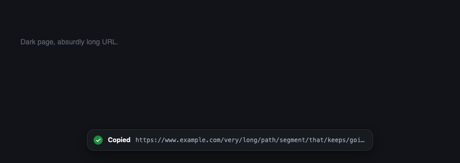

# Quick Copy

A Chrome extension that copies the current tab's URL to the clipboard with a key combination. It has no popup and no options page, and it shows a small confirmation pill at the bottom of the page once the copy succeeds.

`⌘⇧C` copies the URL. `⌘⇧M` copies it as `[Page title](url)`.

<p align="center">
  
  
</p>

A reimplementation of [Ctrl_Shift_C](https://github.com/TheTahsinShahriar/Ctrl_Shift_C) with a different set of tradeoffs. No code was copied from it.

## Install

```sh
npm install
npm run build
```

Then open `chrome://extensions`, switch on Developer mode, click Load unpacked, and pick this repo's `dist/` folder. Rebind the keys at `chrome://extensions/shortcuts`.

## Layout

```
quick-copy/
├── manifest.json          # MV3, 4 permissions, no host access
├── src/
│   ├── background.ts      # service worker: shortcut → payload → clipboard → feedback
│   ├── offscreen.ts       # the only clipboard write in the codebase
│   └── toast.ts           # the bottom-of-page confirmation pill
├── static/offscreen.html  # hidden document host
├── icons/                 # icon.svg + 16/48/128 PNGs
├── docs/                  # toast screenshots
├── scripts/
│   ├── build.mjs          # copies assets into dist/, validates icon paths
│   └── check-render.mjs   # tests the payload formatting against dist/
└── dist/                  # ← load this in Chrome
```

## How it works

### Permissions

The manifest asks for `activeTab`, `clipboardWrite`, `offscreen` and `scripting`. There are no host permissions, so installing the extension does not trigger the "read and change all your data on all websites" warning. `activeTab` is granted by the keystroke that fires the command, which is enough to read the active tab's URL and to inject the toast.

`activeTab` does not cover restricted pages, so `chrome://` tabs get a red `✕` and no pill. To restore URL copying there, add `"tabs"` to `permissions` in `manifest.json` and rebuild. That costs a "read your browsing history" warning and needs no code changes.

### Clipboard

An offscreen document does the write. MV3 service workers have no DOM, and `navigator.clipboard.writeText()` refuses to run in a document that is not focused, which offscreen documents never are. `document.execCommand("copy")` has no focus requirement, and the `clipboardWrite` permission keeps it working even though the API is deprecated for normal web pages.

The document is created on the first copy and reused afterwards, so later copies cost one message hop. Concurrent calls share a single in-flight promise, because `createDocument()` throws `Only a single offscreen document may be created` when two tabs fire at the same time.

### Toast

The pill is fixed to the bottom centre of the viewport, fades in over 200 ms, stays for two seconds and removes itself. Pressing the shortcut again replaces the current pill instead of stacking a second one.

It lives in a closed shadow root on `document.documentElement`, so page CSS cannot restyle it and its own styles cannot leak out. `pointer-events: none` keeps it from intercepting clicks. The URL goes in as `textContent` because a URL is untrusted input.

Chrome refuses injection on `chrome://` pages, the Web Store and the PDF viewer. The toolbar badge is the only feedback available there, and the failed injection is ignored rather than reported, since the copy itself usually still succeeded.

### Badge

Badges are set per tab ID, so a stale check disappears with the tab it belonged to. Every invocation also clears the badge before starting, and the badge is cleared on install and on browser startup in case a worker was torn down mid-timer.

The service worker shows `✓` only when the offscreen document reports that the clipboard write returned true. The offscreen document responds synchronously with the real result, so a success message always corresponds to a write that happened.

## Comparison

| | Ctrl_Shift_C | Quick Copy |
|---|---|---|
| Runtime JS | ~1.6 KB | ~8.0 KB |
| Permissions | 4 | 4 |
| Host permissions | `<all_urls>` | none |
| Host-access install warning | yes | no |
| Injects into page | to reach the clipboard | only to draw the toast |
| Works on `chrome://` | yes | no (one-line opt-in) |
| Copy confirmation | none in the code | badge and in-page pill |
| Build step | none | `tsc` |

This version ships more JavaScript than the original, mostly because the toast accounts for about 3.6 KB of the 8 KB and almost all of that is CSS. The reduction is in the permission model: no host permissions, no standing page access, and the page is only touched after a copy has already succeeded.

## Development

```sh
npm run typecheck   # strict tsc, no emit
npm run build
node scripts/check-render.mjs
```

To check it by hand, load `dist/`, press `⌘⇧C` on a normal page and confirm the pill appears at the bottom and the URL pastes. Then try a `chrome://` page and confirm you get `✕` rather than a false `✓`.

## License

GPL-3.0, matching the project this reimplements. No code was copied from it.
