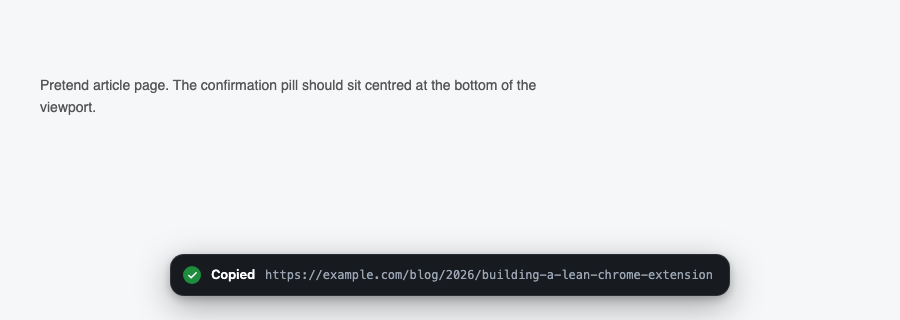

# Quick Copy

A Chrome extension that puts the current tab's URL on your clipboard with one keystroke, and shows you a confirmation pill at the bottom of the page so you know it landed. No popup window, no toolbar fiddling, no page injection before you ask for it.

`⌘⇧C` → copy URL · `⌘⇧M` → copy `[Page title](url)`

<p align="center">
  
  
</p>

This is a lean reimplementation of [Ctrl_Shift_C](https://github.com/TheTahsinShahriar/Ctrl_Shift_C) with a different set of tradeoffs — see [Design notes](#design-notes).

## Install

```sh
npm install
npm run build
```

Then `chrome://extensions` → enable **Developer mode** → **Load unpacked** → pick this repo's `dist/` folder.

The manifest asks for **no host permissions**, so installing it never triggers the "read and change all your data on all websites" warning. Rebind the keys at `chrome://extensions/shortcuts`.

## Why not Rust

A Chrome extension is not a binary. Chrome loads a manifest plus JS/HTML/CSS and nothing else — there is no slot to put a native executable in, and no `chrome.*` API bridge for one.

The only way to "use Rust" here is to compile it to WebAssembly and ship it alongside JS glue. That means paying roughly 100 KB of `.wasm` plus a JS shim to eventually call one line of DOM clipboard API. The entire extension as it stands is **8 KB of JS**. WASM would make it ~12× bigger and add a compile step and a module fetch on every service-worker start, in exchange for zero work Rust is uniquely good at.

So Rust is genuinely the wrong tool for this product. The performance win in a copy-URL extension isn't instruction throughput — it's how many Chrome round-trips and processes you touch per keystroke, and that's an architecture question. TypeScript with `strict` on and no runtime dependencies gives you the same 8 KB with types that catch the actual bugs (see below).

**Where Rust does make sense:** if you want a *native* macOS tool instead — a menu-bar app, a global-hotkey daemon, or something that also grabs the URL from Safari and Arc. That's a different product, and Rust (or Swift) would be the right call. Happy to build that instead.

## What's in the box

```
quick-copy/
├── manifest.json          # MV3, 4 permissions, no host access
├── src/
│   ├── background.ts      # service worker: shortcut → payload → clipboard → feedback
│   ├── offscreen.ts       # the only clipboard write in the codebase
│   └── toast.ts           # the bottom-of-page confirmation pill
├── static/offscreen.html  # hidden document host
├── icons/                 # icon.svg + 16/48/128 PNGs
├── docs/                  # toast screenshots
├── scripts/
│   ├── build.mjs          # copies assets into dist/, validates icon paths
│   └── check-render.mjs   # tests the payload formatting against dist/
└── dist/                  # ← load this in Chrome
```

## Feedback

Two layers, because they have different reach:

| | Where it works | Costs |
|---|---|---|
| Toolbar badge `✓` | everywhere, including `chrome://` pages | ~1 ms, no injection |
| Bottom pill | normal pages, where injection is allowed | ~10 ms, one injection |

The pill is anchored `position: fixed` at the bottom centre of the viewport, so it appears at the bottom of the screen regardless of scroll position. It fades in over 200 ms, sits for 2 s, fades out, and removes itself. Pressing the shortcut again replaces the current pill rather than stacking a second one.

It lives in a **closed shadow root** on `document.documentElement`. Page CSS cannot restyle it, its CSS cannot leak out, and `pointer-events: none` means it can never intercept a click. The URL is inserted with `textContent`, never `innerHTML` — a URL is untrusted input.

On restricted pages (`chrome://`, the Web Store, the PDF viewer) injection is refused by Chrome. That is expected: the badge is the only feedback possible there, and the failure is swallowed rather than surfaced as an error, because the copy itself often still succeeded.

## Design notes

### One clipboard path instead of two

The usual approach (and the one in the original) is: try injecting a `<textarea>` into the page, and fall back to an offscreen document when that fails. Two code paths, two failure modes, two things to keep in sync.

Injecting into the page to reach the clipboard costs you a mutation of the user's DOM, stolen focus and selection, and a hard failure on any site with a strict CSP or no `<body>`. This version skips injection for the *copy* entirely — a hidden offscreen document does the write, created on first use and reused afterwards, so the first copy pays a document spawn and every copy after that is one message hop. The only thing injected is the confirmation pill, and only after the clipboard write already succeeded.

### `activeTab` instead of `<all_urls>`

`activeTab` is granted by the same keystroke that triggers the command, so the extension can read the active tab's URL and inject its own toast without requesting standing access to every site you visit. That keeps `<all_urls>` and `tabs` out of the manifest.

The cost: `activeTab` does not cover restricted pages, so `chrome://` tabs get a red `✕` and no pill. That's the one thing the original does that this doesn't. If you want it back, add `"tabs"` to `permissions` in `manifest.json` and rebuild — it costs a "read your browsing history" warning and nothing else, since no code changes are needed.

### Feedback you can trust

The service worker asks the offscreen document for the actual result of the clipboard write and only shows `✓` / "Copied" if it got `true` back. There is no path in this codebase where a success message appears without a confirmed write.

Badges are set per tab ID, so a stale `✓` is destroyed along with the tab it belonged to. As a second backstop, every invocation clears the badge before it starts, and the badge is cleared on install and browser startup in case a worker was torn down mid-timer.

### The race that bites everyone

`chrome.offscreen.createDocument()` throws `Only a single offscreen document may be created` if two tabs fire the shortcut close together. Both callers share one in-flight promise, and the error is swallowed when it's that specific one — because a document existing is the outcome we wanted anyway.

## Honest comparison

| | Ctrl_Shift_C | Quick Copy |
|---|---|---|
| Runtime JS | ~1.6 KB | ~8.0 KB |
| Permissions | 4 | 4 |
| Host permissions | `<all_urls>` | **none** |
| Host-access install warning | yes | no |
| Injects into page | to reach the clipboard | only to draw the toast |
| Works on `chrome://` | yes | no (one-line opt-in) |
| Copy confirmation | not implemented in source | badge + in-page pill |
| Build step | none | `tsc` |

It is not smaller — the original is tiny, skips verified feedback, and has no toast. It is smaller in *trust surface*: no host permissions, no standing page access, and the page is only touched after a copy has already succeeded. The toast is ~3.6 KB of the 8 KB, almost all of it CSS.

## Verifying

```sh
npm run typecheck   # strict tsc, no emit
npm run build
node scripts/check-render.mjs
```

Manual check: load `dist/`, press `⌘⇧C` on a normal page and confirm the pill appears at the bottom and the URL pastes. Then try a `chrome://` page and confirm you get `✕` rather than a false `✓`.

## License

GPL-3.0, matching the project this reimplements. No code was copied from it — the architecture is deliberately different.
